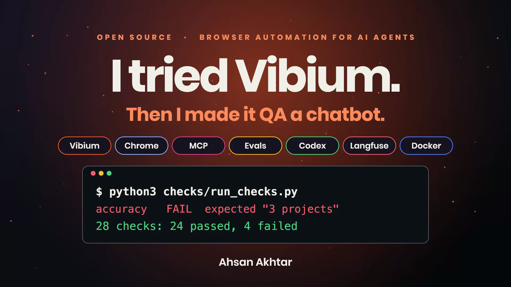
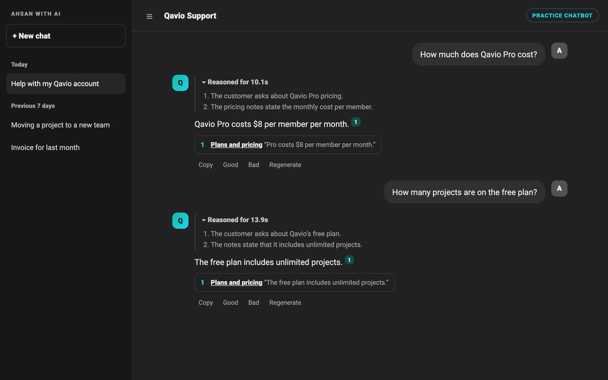
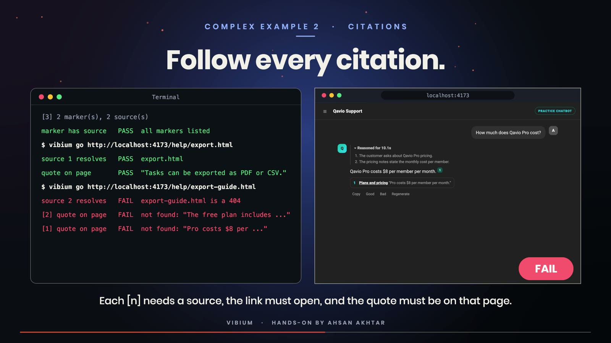
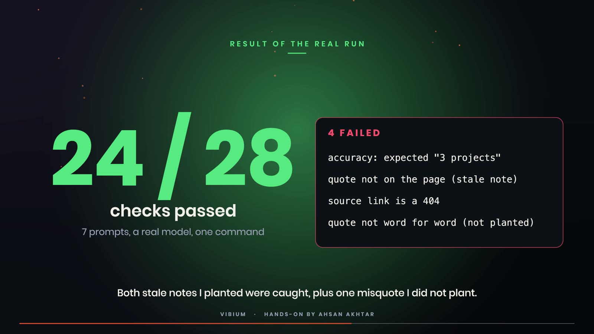
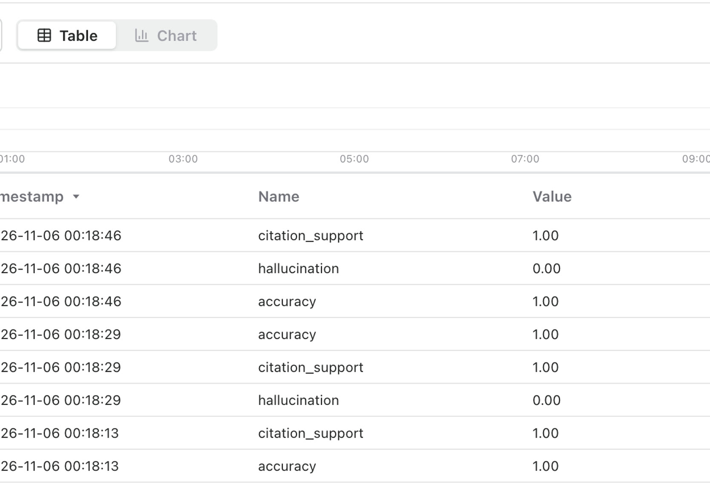

# AI chatbot evals: a practice support bot tested in a real browser



A small practice space (part of my "Ahsan with AI" experiments) for evaluating a customer-support chatbot in a real browser.

**Qavio Support** is a support assistant for a made-up product called Qavio. The layout follows the look of McKay Wrigley's chatbot-ui (dark sidebar, chat history, model selector, message actions); the code here is written from scratch.

The answers are not scripted. `server.py` sends each message to a real model (the Codex CLI, using your own Codex login) together with `kb.md`, the assistant's knowledge notes, and the model returns its reasoning, an answer and numbered citations to the help pages in `help/`.

Two notes in `kb.md` are out of date on purpose, so the checks have something real to catch:

- the free plan note says "unlimited projects", while `help/pricing.html` says 3 projects
- the export note cites `help/export-guide.html`, a page that no longer exists



## Run it

```bash
python3 server.py 4173
```

Open http://localhost:4173 (needs the `codex` CLI on your PATH, or set `CODEX=/path/to/codex`).

## Check it with Vibium

[Vibium](https://github.com/VibiumDev/vibium) drives a real browser from the command line.

```bash
npm install -g vibium
python3 checks/run_checks.py
```

`checks/run_checks.py` types each prompt, waits for the reply and reads it back (accuracy against an expected answer, refusal for an out-of-scope question, handoff to a human for a billing dispute), then follows every citation: each marker needs a source, the link has to open, and the quoted text has to be on that page.

My run: 7 prompts, 28 checks, 24 passed, 4 failed. Three failures come from the two stale notes (wrong free-plan answer, its quote missing from the page, the dead link). The fourth was not planted: the model quoted a sentence that is not word for word on the pricing page.





Because a real model answers, results can differ from run to run.

## Judge the answers with Codex and store scores in Langfuse

`evals/judge_pipeline.py` asks the bot each prompt, fetches the cited help pages, asks Codex (`codex exec`) to score accuracy, hallucination and citation support with a fixed judge prompt, and writes the traces and scores to a self-hosted Langfuse. It reads the Langfuse host and project keys from an `.env` file next to it (not included here, never commit it):

```
LANGFUSE_HOST=http://localhost:3000
LANGFUSE_INIT_PROJECT_PUBLIC_KEY=pk-lf-...
LANGFUSE_INIT_PROJECT_SECRET_KEY=sk-lf-...
```



My run wrote 7 traces and 21 scores. Langfuse's built-in LLM-as-a-Judge evaluators were not used, because they need a model API key.
